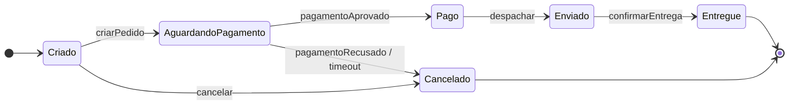
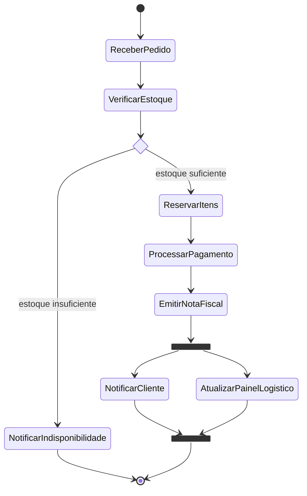

# Aula 3 — UML: Máquina de Estados e Atividades

## Por onde começar

1. [O papel dos diagramas](docs/01-papel-dos-diagramas.md) — que pergunta cada diagrama responde.
2. [Máquina de estados](docs/02-maquina-de-estados.md) — ciclo de vida de um pedido, eventos, guardas e ações.
3. [Diagrama de atividades](docs/03-diagrama-de-atividades.md) — fluxo, decisões e caminhos paralelos.
4. [Comparação](docs/04-comparacao.md) — diferenças e uso conjunto.
5. [Como escolher](docs/05-escolhendo-o-diagrama.md) — critérios de escolha e árvore de decisão.
6. [Exercícios](exercicios/README.md) — conta, assinatura, aprovação de crédito e checkout, com gabaritos.
7. [Glossário](glossario.md) — termos essenciais em uma consulta rápida.

## Dois exemplos centrais

### Ciclo de vida de um pedido

Um pedido nasce em `Criado`, aguarda o pagamento e segue para entrega ou cancelamento. O modelo permite cancelar antes do envio; não define cancelamento depois que o pedido foi enviado.

Fonte: [`diagramas/pedido-estados.mmd`](diagramas/pedido-estados.mmd).

### Processamento do pedido

O fluxo decide o que fazer com o estoque e, quando o processamento é bem-sucedido, executa duas ações paralelas. A conclusão aguarda ambas.

Fonte: [`diagramas/pedido-atividades.mmd`](diagramas/pedido-atividades.mmd). Uma representação alternativa em fluxograma está em [`diagramas/pedido-atividades-flowchart.mmd`](diagramas/pedido-atividades-flowchart.mmd).

## Regra rápida

- **Ciclo de vida de uma entidade** e suas transições válidas: máquina de estados.
- **Processo ponta a ponta**, decisões ou paralelismo: atividades.
- **Colaboração pontual entre objetos** em um cenário: sequência.
- Os três diagramas podem descrever aspectos complementares do mesmo sistema.

## Checklist de revisão

- [ ] Sei explicar a diferença entre estado e ação.
- [ ] Identifico os dois estados finais do pedido: `Entregue` e `Cancelado`.
- [ ] Reconheço a decisão e o fork/join no processamento do pedido.
- [ ] Escolho entre estados, atividades e sequência conforme a pergunta que quero responder.
