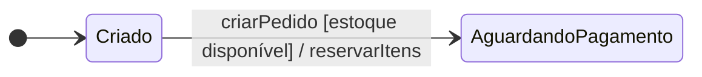
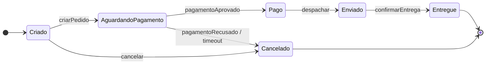

# 2. Diagrama de máquina de estados

Uma máquina de estados representa o ciclo de vida de uma entidade: estados estáveis, eventos que provocam mudanças e, quando necessário, condições e ações associadas às transições.

## Elementos

| Elemento | Notação / leitura | Significado |
|---|---|---|
| Estado | Retângulo arredondado | Condição estável do objeto por um intervalo de tempo. |
| Transição | Seta entre estados | Mudança de um estado para outro. |
| Evento | `evento` | Fato que dispara a transição. |
| Guarda | `[condição]` | Condição que precisa ser verdadeira para a transição ocorrer. |
| Ação | `/ ação` | Ação executada durante a transição. |
| Estado inicial | Círculo preenchido | Ponto de entrada; deve haver um único estado inicial. |
| Estado final | Círculo dentro de círculo | Fim de um caminho; pode haver mais de um estado final. |

Uma transição pode ser escrita como `evento [guarda] / ação`. Por exemplo, `criarPedido [estoque disponível] / reservarItens` indica que o evento inicia a transição somente quando há estoque e que a reserva é realizada durante ela.

Fonte: [`../diagramas/pedido-transicao-guardas-acoes.mmd`](../diagramas/pedido-transicao-guardas-acoes.mmd).

## Exemplo: pedido

O pedido começa em `Criado`. O evento `criarPedido` o leva a `AguardandoPagamento`. Se o pagamento for aprovado, passa por `Pago` e `Enviado` até `Entregue`. Se for recusado ou expirar, é cancelado. Também é possível cancelar enquanto está `Criado`.

Fonte: [`../diagramas/pedido-estados.mmd`](../diagramas/pedido-estados.mmd).

O modelo tem dois estados finais: `Entregue` e `Cancelado`. Ele não mostra uma transição de cancelamento a partir de `Enviado`; a ausência dessa transição documenta que essa regra não é permitida no modelo.

## Quando usar

Use máquina de estados quando a pergunta central for “quais estados esta entidade pode assumir e quais eventos permitem mudar de estado?” Exemplos típicos são `Pedido`, `Conta` e `Assinatura`.

## Checklist de revisão

- [ ] O diagrama tem um único estado inicial.
- [ ] Os eventos nas setas explicam o que dispara cada mudança.
- [ ] Guardas e ações estão associadas à transição correta, quando aplicáveis.
- [ ] Os estados finais representam todos os encerramentos relevantes.
- [ ] As transições ausentes são compatíveis com as regras de negócio pretendidas.
