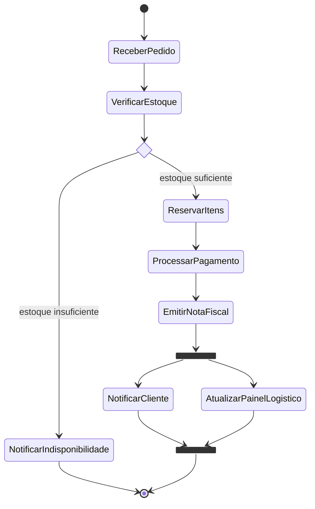
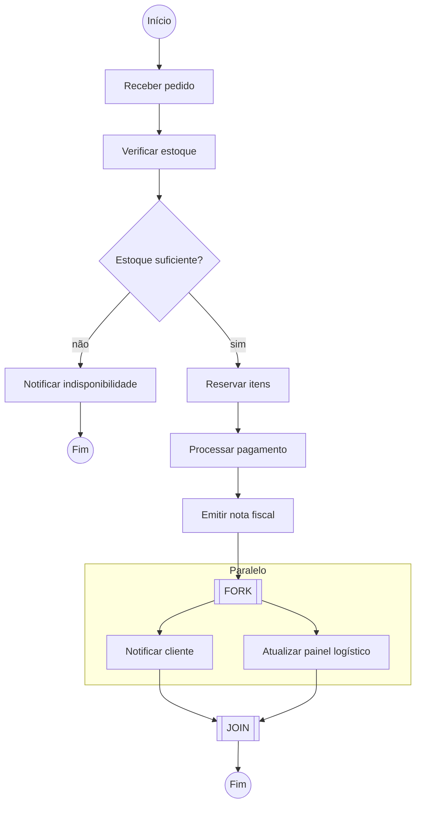
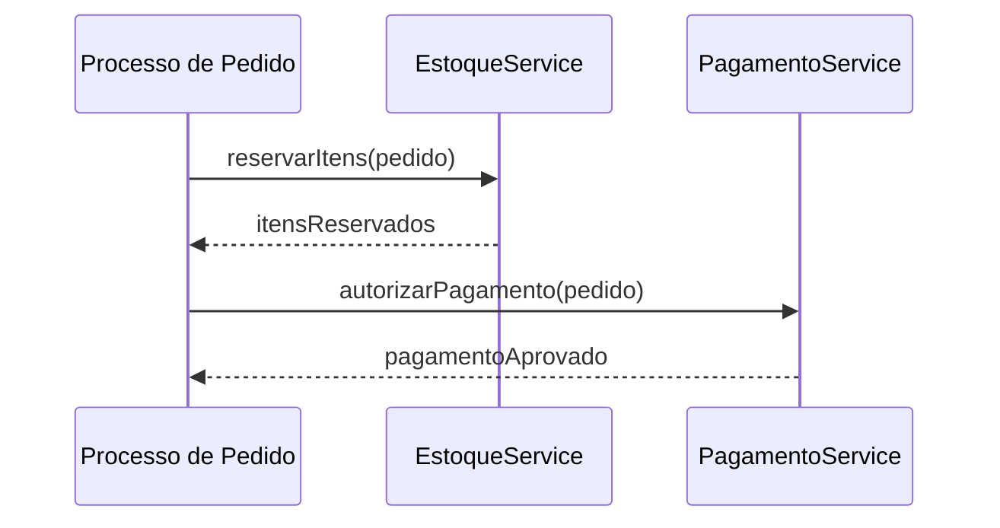

# 3. Diagrama de atividades

Um diagrama de atividades descreve o fluxo de um processo ou algoritmo. Seu foco são as ações e o fluxo de controle, não o ciclo de vida de uma única entidade.

## Elementos

| Elemento | Notação / leitura | Significado |
|---|---|---|
| Nó inicial | Círculo preenchido | Início do fluxo. |
| Ação | Retângulo arredondado | Trabalho realizado em uma etapa. |
| Decisão | Losango, com guardas nas saídas | Escolha de um caminho conforme uma condição. |
| Fork | Barra que divide o fluxo | Início de caminhos paralelos. |
| Join | Barra que sincroniza caminhos | Aguarda os caminhos paralelos antes de continuar. |
| Nó final | Círculo final | Término do fluxo. |

## Exemplo: processamento do pedido

O processo recebe o pedido e verifica o estoque. Se não houver estoque suficiente, notifica a indisponibilidade e termina. Caso contrário, reserva os itens, processa o pagamento e emite a nota fiscal. Depois, notifica o cliente e atualiza o painel logístico em paralelo; o fluxo termina apenas quando ambos os caminhos chegam ao join.

O Mermaid não possui um tipo nativo específico para atividades. A representação abaixo usa `stateDiagram-v2`, que oferece os nós `<<choice>>`, `<<fork>>` e `<<join>>`.

Fonte: [`../diagramas/pedido-atividades.mmd`](../diagramas/pedido-atividades.mmd).

### Alternativa visual: fluxograma

O mesmo processo também pode ser representado como fluxograma. Aqui, uma subgraph destaca visualmente os dois caminhos paralelos.

Fonte: [`../diagramas/pedido-atividades-flowchart.mmd`](../diagramas/pedido-atividades-flowchart.mmd).

## Refinar uma ação com sequência

Uma ação do processo pode ser detalhada por uma interação entre objetos. Por exemplo, a reserva de itens e a autorização do pagamento podem ser explicadas com um diagrama de sequência.

Fonte: [`../diagramas/pedido-refinamento-sequencia.mmd`](../diagramas/pedido-refinamento-sequencia.mmd).

## Quando usar

Use atividades para explicar um processo de ponta a ponta, especialmente quando houver decisões, vários participantes ou caminhos paralelos que precisam sincronizar.

## Checklist de revisão

- [ ] O fluxo parte de um nó inicial e chega a um ou mais fins coerentes.
- [ ] Cada saída da decisão está identificada com sua condição.
- [ ] O fork divide o trabalho e o join aguarda todos os caminhos necessários.
- [ ] As ações representam etapas do processo, não estados persistentes de uma entidade.
