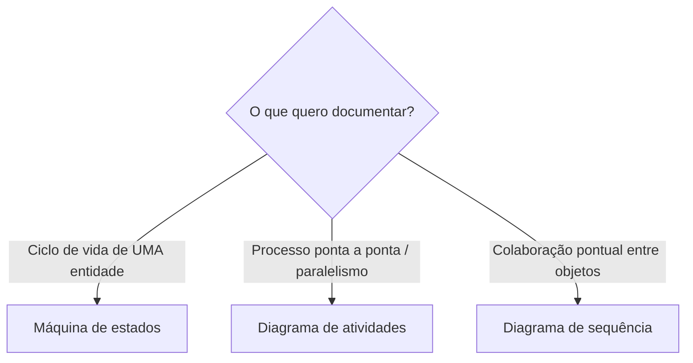

# 5. Como escolher o diagrama

Comece pela pergunta que a documentação precisa responder. O diagrama adequado é o que torna essa resposta mais clara.

Fonte: [`../diagramas/escolha-do-diagrama.mmd`](../diagramas/escolha-do-diagrama.mmd).

## Critérios práticos

- **Máquina de estados:** use quando o objeto central tiver estados relevantes e transições válidas determinadas por eventos; por exemplo, `Pedido`, `Conta` ou `Assinatura`.
- **Atividades:** use para um processo de negócio ponta a ponta, com etapas, decisões, múltiplas entidades ou paralelismo.
- **Sequência:** use para uma colaboração pontual entre objetos em um cenário.

Na prática, um mesmo sistema pode usar os três. Um diagrama de atividades mostra o processo em nível mais alto; uma sequência refina a colaboração de uma ação; uma máquina de estados registra as mudanças permitidas na entidade central.

## Quando usar

Use esta árvore como ponto de partida e escolha o nível de detalhe conforme a dúvida do leitor. Não é necessário forçar todo o comportamento de um sistema em um único diagrama.

## Checklist de revisão

- [ ] O propósito do diagrama está explícito.
- [ ] O nível de abstração é adequado à pergunta.
- [ ] O diagrama escolhido comunica eventos/estados, fluxo/ações ou mensagens, conforme necessário.
- [ ] Quando útil, os diagramas complementares estão conectados por uma explicação.
