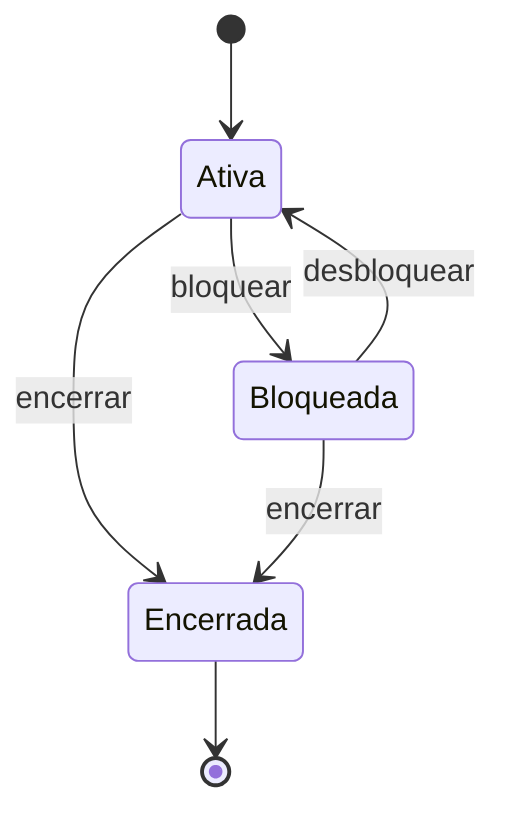
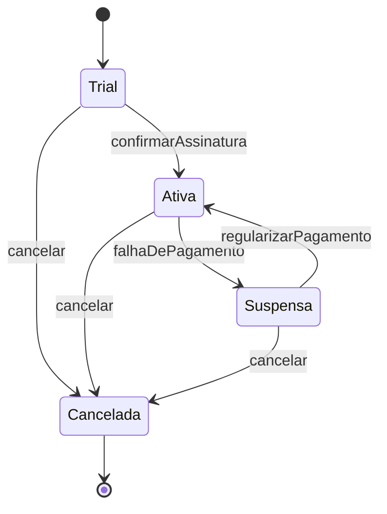
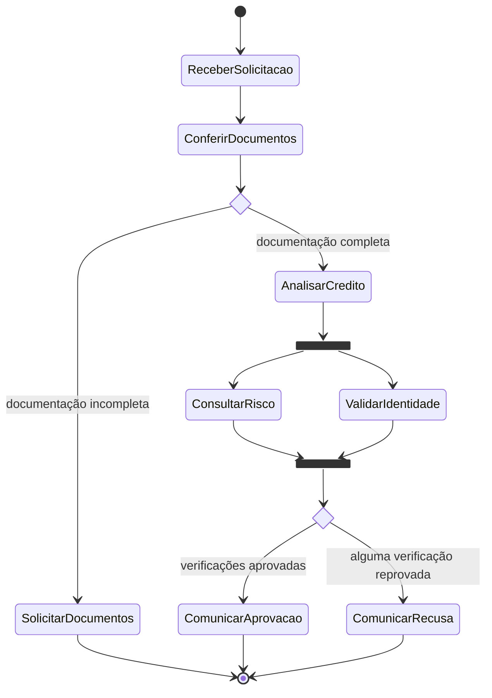
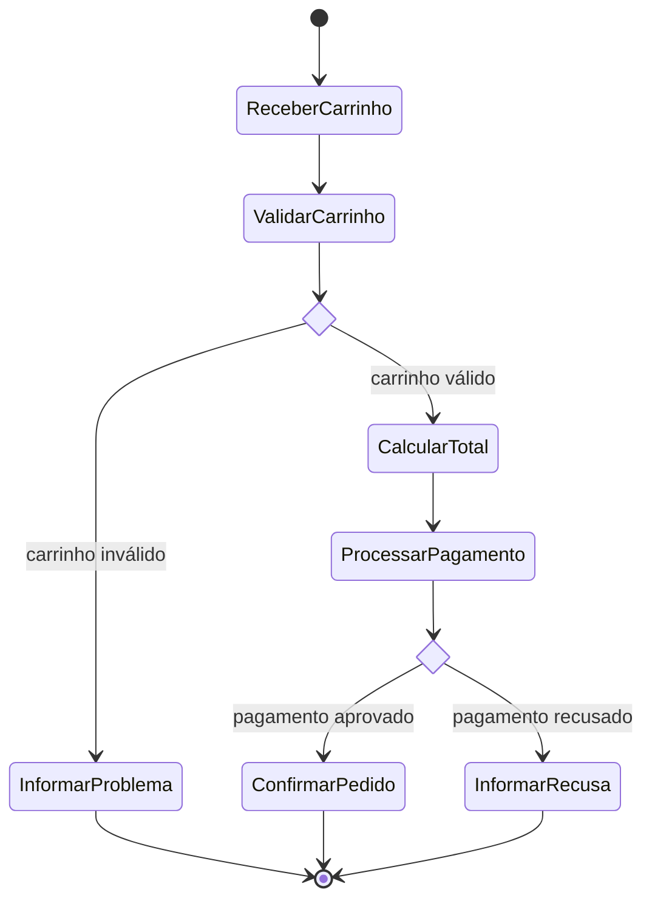

# Exercícios

Os enunciados abaixo são **exemplos adicionais** para praticar a aplicação dos conceitos da aula; não são requisitos ou exemplos dos slides. Cada proposta inclui um gabarito Mermaid. Os gabaritos são modelos didáticos: regras de negócio adicionais podem exigir outros estados, eventos ou caminhos.

## 1. Conta bancária — máquina de estados

**Enunciado:** modele uma conta que começa ativa, pode ser bloqueada e desbloqueada, e pode ser encerrada. Uma conta encerrada é final.

**Gabarito:**

Fonte: [`../diagramas/exercicio-conta-estados.mmd`](../diagramas/exercicio-conta-estados.mmd).

## 2. Assinatura — máquina de estados

**Enunciado:** modele uma assinatura que inicia em período de teste, pode ser ativada, suspensa ou cancelada. Uma assinatura cancelada é final.

**Gabarito:**

Fonte: [`../diagramas/exercicio-assinatura-estados.mmd`](../diagramas/exercicio-assinatura-estados.mmd).

## 3. Aprovação de crédito — atividades

**Enunciado:** modele a análise de uma solicitação. Uma decisão encaminha solicitações incompletas para pedir documentos e as completas para análise. Após a aprovação, consultar risco e validar identidade ocorrem em paralelo; ambos devem terminar antes da decisão final.

**Gabarito:**

Fonte: [`../diagramas/exercicio-aprovacao-credito-atividades.mmd`](../diagramas/exercicio-aprovacao-credito-atividades.mmd).

## 4. Checkout — atividades

**Enunciado:** modele um checkout que valida o carrinho. Se inválido, informa o problema e termina; se válido, calcula o total e processa o pagamento. Pagamento aprovado confirma o pedido; pagamento recusado informa a recusa.

**Gabarito:**

Fonte: [`../diagramas/exercicio-checkout-atividades.mmd`](../diagramas/exercicio-checkout-atividades.mmd).

## Checklist de revisão

- [ ] Cada máquina de estados tem um estado inicial e encerramentos coerentes.
- [ ] Os eventos deixam claras as mudanças de estado.
- [ ] As decisões dos fluxos têm saídas identificadas.
- [ ] O join aguarda os caminhos paralelos necessários antes de continuar.
- [ ] Distingo os exemplos adicionais do conteúdo de referência da aula.
