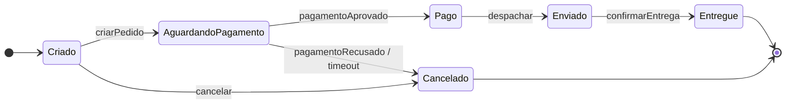
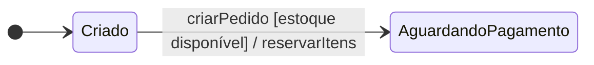
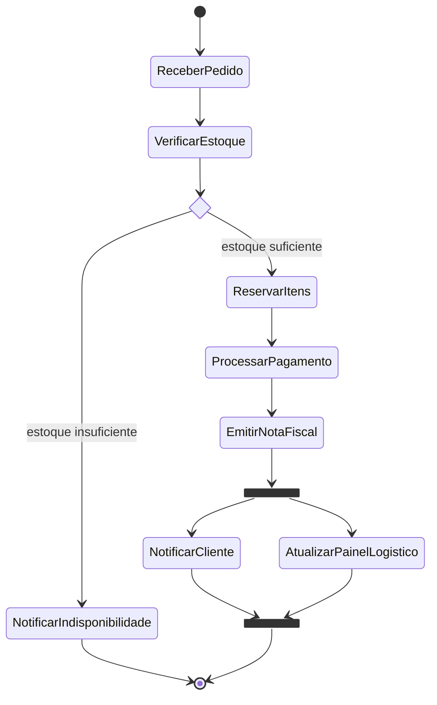
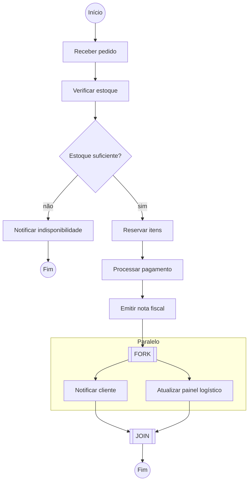
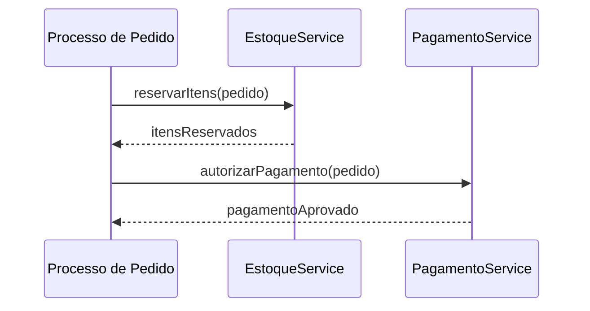
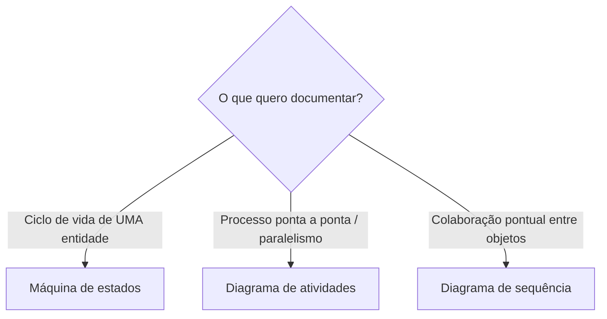

# Aula 3 — UML: Máquina de Estados e Atividades

> **Curso:** Arquitetura de Sistemas e Microsserviços · **Unidade 1 · Aula 3** · Prof. Nataniel Paiva
> **Fonte:** `Aula3_..._UML Máquina de Estados e Atividades_unidade01_aula03.pptx` (31 slides)

Este README é um **briefing para outra IA** criar um projeto visual, didático e navegável sobre o conteúdo da aula. Tudo o que está aqui foi extraído dos slides; os diagramas Mermaid abaixo são **exemplos prontos** que renderizam direto no GitHub.

---

## 1. Objetivo do projeto a ser gerado

Criar um repositório (ou site estático) em que cada conceito da aula tenha **explicação curta + diagrama Mermaid + exemplo comentado**, para estudo e consulta rápida.

**Público:** estudantes de arquitetura de software. **Idioma:** português (PT-BR). **Tom:** didático e objetivo.

## 2. Resumo do conteúdo (fonte de verdade)

### 2.1 Por que esses diagramas existem
- Diagrama de **classes** = o que o objeto *é*; de **sequência** = interação pontual entre objetos.
- **Máquina de estados** preenche a lacuna do *ciclo de vida de um objeto*; **atividades** preenche a lacuna do *fluxo de um processo* (vários atores, atividades paralelas).

### 2.2 Diagrama de máquina de estados (state machine)
| Elemento | Notação | Significado |
|---|---|---|
| Estado | retângulo arredondado | condição estável do objeto por um intervalo de tempo |
| Transição | seta | mudança de estado, rotulada com `evento [guarda] / ação` |
| Evento | rótulo da seta | o que dispara a transição |
| Guarda | `[condição]` | condição que precisa ser verdadeira (ex.: `[estoque disponível]`) |
| Ação | `/ ação` | executada durante a transição |
| Estado inicial | círculo preenchido | ponto de entrada (obrigatório, um só) |
| Estado final | círculo dentro de círculo | pode haver **mais de um** (ex.: `Entregue` e `Cancelado`) |

**Exemplo comentado (Figura 6 – Pedido):** nasce em `Criado` → evento `criarPedido` → `AguardandoPagamento`. Pagamento aprovado → `Pago` → `Enviado` → `Entregue`. Pagamento recusado/expirado (`pagamentoRecusado / timeout`) → `Cancelado`. Cancelar a partir de `Criado` é modelado; **após o envio essa transição não existe** — o diagrama documenta a regra de negócio *por omissão*.

### 2.3 Diagrama de atividades
Elementos: nó inicial (círculo cheio), **ações** (retângulo arredondado), **decisão** (losango com guardas nas saídas), **fork** (barra que divide em ramos paralelos), **join** (barra que sincroniza os ramos), nó final.

**Exemplo comentado (Figura 7 – processamento do pedido):** recebe pedido → verifica estoque → decisão: se insuficiente, `Notificar indisponibilidade` e fim; se suficiente, reserva e paga, emite nota fiscal e faz **fork** em `Notificar cliente` ‖ `Atualizar painel logístico`, que devem terminar ambos (**join**) antes de encerrar.

### 2.4 Comparação
| | Máquina de estados | Atividades |
|---|---|---|
| Foco | ciclo de vida de **um objeto** | fluxo de um **processo/algoritmo** |
| Elemento central | estado + transição por evento | ação + fluxo de controle |
| Paralelismo | não representado diretamente | nativo (fork/join) |
| Orientação | a **estados** | a **ações** |
| Uso típico | status de entidade (Pedido, Conta) | processo de negócio (aprovação, checkout) |

### 2.5 Como escolher o diagrama
- Estados e transições válidas de uma entidade central (Pedido, Conta, Assinatura) → **máquina de estados**.
- Processo de negócio ponta a ponta, mais de uma entidade, paralelismo → **atividades**.
- Colaboração pontual entre objetos em um cenário → **sequência**.
- Na prática, um mesmo sistema usa **os três em conjunto**; sequência pode refinar cada ação de uma atividade (níveis de abstração).

---

## 3. Exemplos Mermaid (renderizam no GitHub)

### 3.1 Máquina de estados — ciclo de vida do Pedido (Figura 6)



### 3.2 Transição com evento, guarda e ação



### 3.3 Diagrama de atividades com decisão e fork/join (Figura 7)

O Mermaid não tem "diagrama de atividades" nativo; usa-se `stateDiagram-v2` (que suporta `<<choice>>`, `<<fork>>` e `<<join>>`):



### 3.4 Mesma atividade como flowchart com raias (alternativa visual)



### 3.5 Refinando uma ação com diagrama de sequência



### 3.6 Escolha do diagrama (árvore de decisão)



---

## 4. Estrutura sugerida do projeto a gerar

```
aula3-projeto/
├── README.md                    # visão geral + índice com diagramas embutidos
├── docs/
│   ├── 01-papel-dos-diagramas.md
│   ├── 02-maquina-de-estados.md
│   ├── 03-diagrama-de-atividades.md
│   ├── 04-comparacao.md
│   └── 05-escolhendo-o-diagrama.md
├── diagramas/                   # um .mmd por diagrama (fonte versionável)
│   ├── pedido-estados.mmd
│   ├── pedido-atividades.mmd
│   └── ...
├── exercicios/                  # propostas com gabarito em Mermaid
└── glossario.md
```

**Exercícios sugeridos (com gabarito em Mermaid):** estados de `Conta` bancária (ativa/bloqueada/encerrada); estados de `Assinatura` (trial/ativa/suspensa/cancelada); atividade de aprovação de crédito com fork/join; atividade de checkout.

## 5. Regras para a IA que for gerar o projeto

1. **Fidelidade:** não contradiga os slides; o que for ilustrativo (exercícios, exemplos extras) deve ser marcado como *"exemplo adicional"*.
2. **Mermaid no GitHub:** use blocos ```` ```mermaid ````; sem HTML; nomes de estados sem espaços/acentos problemáticos (`AguardandoPagamento`); rótulos com caracteres especiais entre aspas quando necessário.
3. **Um conceito = uma explicação curta + um diagrama + uma frase de "quando usar".**
4. **Mantenha o `.mmd` fonte** de cada diagrama separado, além do embutido no `.md`.
5. **Testar a renderização** (GitHub, mermaid.live ou `mmdc`) antes de entregar.
6. Incluir **tabelas de comparação** e **checklist de revisão** ao final de cada documento.
7. Citar a origem: *Aula 3 — Arquitetura de Sistemas e Microsserviços, Prof. Nataniel Paiva*.

## 6. Checklist de aceitação

- [ ] Máquina de estados do Pedido com **dois estados finais**
- [ ] Atividade do pedido com **decisão + fork/join**
- [ ] Tabela comparativa estados × atividades
- [ ] Critérios de escolha entre estados, atividades e sequência
- [ ] Todos os diagramas renderizam no GitHub sem erro
